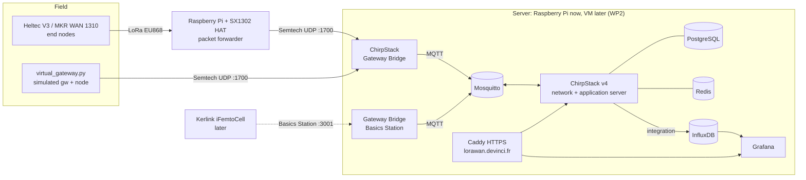

# lorawan.devinci.fr: a sovereign LoRaWAN network for the Pôle Léonard de Vinci

PI² project 017 (ESILV / DVRC). This is a self-hosted, open-source LoRaWAN network that the
school can run 100 % in-house: no The Things Network, no commercial cloud.

This repository is the **WP1 prototype**. It holds the full network/application server stack,
a do-it-yourself gateway, node firmware, and a virtual gateway so everything can be tested
before any radio hardware arrives.



## Repository layout

| Path | What it is |
|---|---|
| `docker-compose.yml` | The whole stack. Core services plus the optional `dashboards` and `public` profiles |
| `configuration/` | ChirpStack (EU868 only), gateway bridges, Mosquitto, Postgres init, Grafana, Caddy |
| `scripts/provision.py` | Creates gateway, device profile (with codec), application, device and InfluxDB integration through the REST API |
| `scripts/virtual_gateway.py` | Simulated gateway and OTAA device over Semtech UDP. Lets you test with zero hardware |
| `scripts/lorawan_crypto.py` | Readable LoRaWAN 1.0.x join, MIC and encryption code (used by the simulator, good for teaching) |
| `codecs/devinci-node-v1.js` | Payload decoder/encoder installed in the device profile |
| `firmware/heltec-v3-otaa/` | PlatformIO project for the Heltec WiFi LoRa 32 V3 (RadioLib) |
| `firmware/mkrwan1310-otaa/` | Arduino sketch for the MKR WAN 1310 |
| `gateway/README.md` | How to build and configure the Raspberry Pi gateway, plus the network flows for the DSI |
| `docs/security-notes.md` | Prototype security posture and hardening backlog (seed for WP3) |
| `tests/` | Offline tests: crypto vs. ChirpStack's own test vectors, simulator E2E, provisioning, codec |

## Quick start (no radio hardware)

Requirements: Docker with Compose v2 on a Raspberry Pi 4/5 (64-bit OS) or any Linux/macOS/Windows
machine, plus Python 3.9+.

```bash
make up-all                      # creates .env with random secrets, starts stack + dashboards
# (without make: cp .env.example .env, fill the CHANGE_ME values,
#  then: docker compose --profile dashboards up -d)
```

1. Open **http://localhost:8080**, log in as `admin` / `admin`, and **change the password**.
2. Go to **API keys → Add API key** and copy the token.
3. Provision a gateway and a device:
   ```bash
   pip install -r scripts/requirements.txt
   export CHIRPSTACK_API_KEY=<token>
   export $(grep INFLUXDB_ .env | xargs)          # for --influxdb
   python3 scripts/provision.py --gateway-eui 0016c001ff100001 --influxdb
   ```
4. Run the virtual device using the command `provision.py` printed:
   ```bash
   python3 scripts/virtual_gateway.py --gateway-eui 0016c001ff100001 \
       --dev-eui <dev-eui> --app-key <app-key>
   ```
5. Check each layer:
   - **Gateways:** the gateway is *online*.
   - **Applications → campus-test → node-01 → LoRaWAN frames:** you see JoinRequest, JoinAccept and UnconfirmedDataUp.
   - **Events tab:** `up` events with decoded `temperature_c`, `humidity_pct` and `battery_v`.
   - **Raw MQTT:** `docker compose exec mosquitto mosquitto_sub -t 'application/#' -v`.
   - **Grafana:** http://localhost:3000/grafana/ → *LoRaWAN / lorawan.devinci.fr – devices*.
     Grafana is bound to 127.0.0.1 by default. Set `GRAFANA_BIND=0.0.0.0` and
     `PUBLIC_URL=http://<host-ip>:3000` in `.env` to reach it from another machine.
   - **Downlink:** in the device's *Queue* tab, enqueue `{"interval_s": 120}` on fPort 2. The
     simulator logs `uplink interval set to 120s` after its next uplink.

## Sprint 1: real radio

1. Build the gateway with a Pi and an SX1302 HAT, following [`gateway/README.md`](gateway/README.md).
   Point it at `<server>:1700`.
2. `python3 scripts/provision.py --gateway-eui <real-gateway-id> --device-name heltec-01`.
3. Flash the Heltec. Copy `firmware/heltec-v3-otaa/include/secrets.example.h` to `secrets.h`,
   paste the values `provision.py` printed, then run `pio run -t upload && pio device monitor`.
4. The serial monitor shows `joined`, then uplinks every 5 min. ChirpStack shows them with RSSI and SNR.

Each physical board needs its **own DevEUI and AppKey**: re-run `provision.py` with a new
`--device-name`. For the MKR WAN 1310, read the DevEUI from its serial output and pass
`--dev-eui <it> --mac-version 1.0.2`.

## Going public: lorawan.devinci.fr

```bash
# .env: DOMAIN=lorawan.devinci.fr, PUBLIC_URL=https://lorawan.devinci.fr, CHIRPSTACK_UI_BIND=127.0.0.1
docker compose --profile dashboards --profile public up -d
```

Caddy gets a Let's Encrypt certificate automatically once the DNS record points to the
server and inbound 80/443 are open. Both depend on the DSI (WP2). Until then, `DOMAIN=localhost`
serves HTTPS with Caddy's internal CA.

## Moving off the Pi (WP2)

The stack is plain Docker Compose with named volumes. Moving to an Azure (or on-prem) VM is
`docker compose down`, a `pg_dump` and volume copy, and `up` on the new host. Then repoint the
gateways' server address. Ports to open on the VM: UDP 1700 and TCP 3001 (from the gateway
VLAN only), and TCP 443 (and 80, for the ACME challenge).

## Payload format (devinci-node v1)

fPort 1, 6 bytes, big-endian:

| Bytes | Field | Unit | "Absent" value |
|---|---|---|---|
| 0 | version (`0x01`) | | |
| 1–2 | temperature | int16, 0.01 °C | `0x7FFF` |
| 3 | humidity | uint8, 0.5 % | `0xFF` |
| 4–5 | battery | uint16, mV | `0x0000` |

Downlink on fPort 2: uint16 seconds = new uplink interval (minimum 60).

## Tests

```bash
make test
```

These tests run offline, with no Docker and no hardware:

- **`test_lorawan_crypto`:** join-request, join-accept, session keys and uplink encryption and
  MIC, checked against the test vectors in ChirpStack's own `lrwn` crate.
- **`test_virtual_gateway`:** the simulator against a fake network server over real UDP (join,
  uplinks, downlink, TX_ACK, DevNonce persistence).
- **`test_provision`:** the REST calls and field names, checked against a mock API.
- **`test_codec.js`:** the payload codec.

## Roadmap mapping

| WP | Status in this repo |
|---|---|
| WP1 prototype | Stack, gateway guide, firmware, simulator: done. Real-radio test pending hardware |
| WP2 DSI integration | Network flows in `gateway/README.md`; portable compose; hosting options to write up |
| WP3 risk analysis | `docs/security-notes.md` is the starting inventory |
| WP4 outdoor and mesh | Same server. Outdoor gateways (e.g. RAK7289, Kerlink iStation) via Basics Station. Meshtastic needs separate nodes |
| WP5 regional campuses | One gateway VLAN plus the same compose file per site, or remote gateways on the central server |

## Open questions (for the supervisor and the DSI)

- Is the domain **lorawan.devinci.fr** or **lora.devinci.fr**? (The subject uses both.)
- Who creates the DNS record, and when can 80/443 and UDP 1700 be opened?
- Can we get access to the Kerlink gateways later, and their management credentials?
- Is there a budget for one DIY gateway (Pi + SX1302 HAT + antenna) and a couple of Heltec V3 boards?
